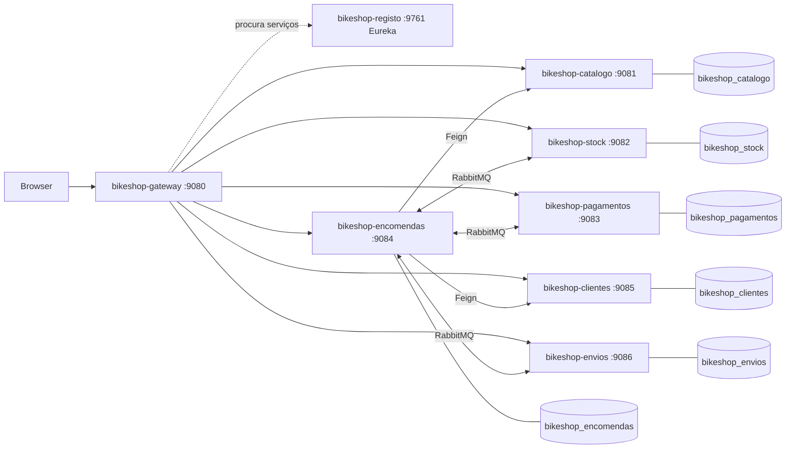
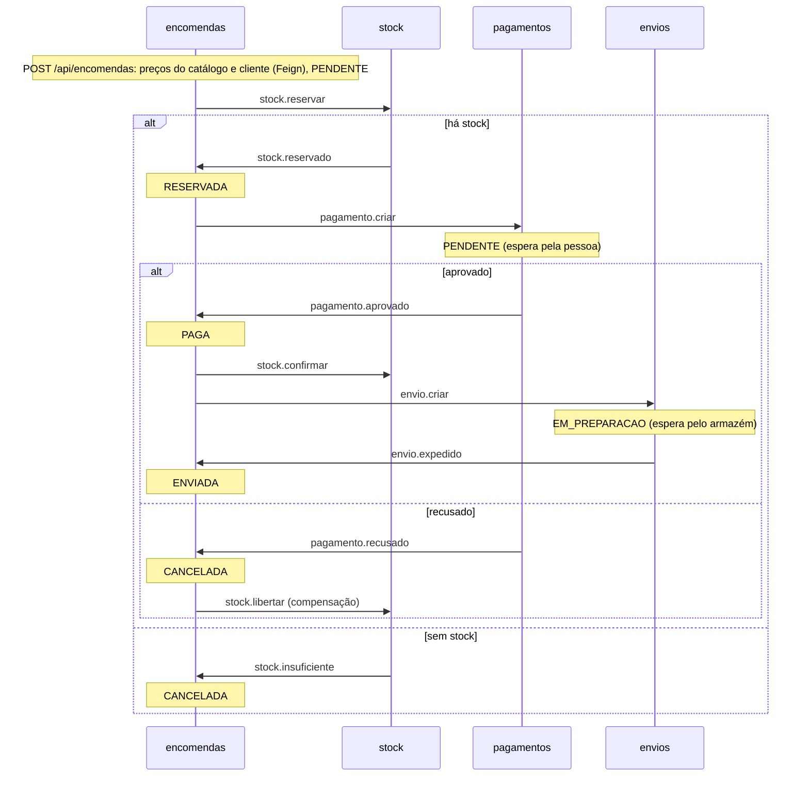

# BikeShop 2.0

Loja de peças para bicicletas elétricas (2026), feita em microsserviços com Spring Boot e Spring Cloud. É um projeto de estudo: pequeno de propósito, para se perceber como as peças encaixam. Usa as tecnologias dos slides da unidade curricular de Microsserviços (MTSDS, ESTG): Eureka, Gateway, OpenFeign, RabbitMQ, Docker e Kubernetes. Além dos slides, tem três boas práticas de 2026: circuit breaker, tracing e Swagger (secção 14).

Os pagamentos e os envios são simulados: não há banco, cartão nem transportadora.

| Versão | Data | O que mudou |
|---|---|---|
| 1.0 | outubro de 2026 | 6 microsserviços (4 de negócio), SAGA entre o stock e os pagamentos, Docker e Minikube |
| 2.0 | 25.10.2026 | 8 microsserviços (2 por equipa): clientes e envios; a encomenda passa a ENVIADA. Spring Boot 4.1, circuit breaker, tracing com Jaeger e Swagger |

Tabela 0: Versões. O resultado do teste da 2.0 está no fim do `RUNBOOK.html`.

## 1. Arquitetura

O browser só fala com a gateway. A gateway encontra cada serviço no registo (Eureka) pelo nome e encaminha o pedido. Cada serviço de negócio tem a sua base de dados. A encomenda chama o catálogo e os clientes por HTTP (Feign): para saber nomes e preços e para registar quem compra. Com o stock, os pagamentos e os envios fala por mensagens (RabbitMQ).



| Módulo | Porta | O que faz | Base de dados | Equipa |
|---|---|---|---|---|
| bikeshop-catalogo | 9081 | Categorias e peças, com preço | bikeshop_catalogo | Catálogo |
| bikeshop-gateway | 9080 | Entrada única (/api/**) e interface web | nenhuma | Catálogo |
| bikeshop-encomendas | 9084 | Encomendas; orquestra a SAGA | bikeshop_encomendas | Encomenda |
| bikeshop-clientes | 9085 | Clientes e moradas de entrega | bikeshop_clientes | Encomenda |
| bikeshop-stock | 9082 | Quantidades em armazém e reservas | bikeshop_stock | Armazém |
| bikeshop-envios | 9086 | Envio de cada encomenda paga (simulado) | bikeshop_envios | Armazém |
| bikeshop-pagamentos | 9083 | Pagamento simulado (aprovar ou recusar) | bikeshop_pagamentos | Pagamento |
| bikeshop-registo | 9761 | Eureka: onde os serviços se registam | nenhuma | Pagamento |

Tabela 1: Módulos. São 8 microsserviços, 2 por equipa (um elemento do grupo por equipa).

Cada serviço segue a mesma organização: controller, service, repository, entity, dto, configuration (com a MQConfig), messages, listeners, publishers e exception.

## 2. A SAGA da encomenda

Uma encomenda mexe em quatro serviços por mensagens (e em dois por Feign, antes de começar). Não há uma transação comum: cada passo é local e, se algo falhar depois, um passo de compensação desfaz o que já foi feito. Quem conduz é a encomenda (SAGA orquestrada).



Todas as mensagens passam pela exchange `bikeshop.eventos` (TopicExchange). Cada serviço declara as filas que consome.

| Routing key | Quem publica | Fila | Quem consome |
|---|---|---|---|
| stock.reservar | encomendas | stock.reservar.fila | stock |
| stock.reservado | stock | encomendas.stock-reservado.fila | encomendas |
| stock.insuficiente | stock | encomendas.stock-insuficiente.fila | encomendas |
| pagamento.criar | encomendas | pagamentos.criar.fila | pagamentos |
| pagamento.aprovado | pagamentos | encomendas.pagamento-aprovado.fila | encomendas |
| pagamento.recusado | pagamentos | encomendas.pagamento-recusado.fila | encomendas |
| stock.confirmar | encomendas | stock.confirmar.fila | stock |
| stock.libertar | encomendas | stock.libertar.fila | stock |
| envio.criar | encomendas | envios.criar.fila | envios |
| envio.expedido | envios | encomendas.envio-expedido.fila | encomendas |

Tabela 2: Mensagens da SAGA (10).

Três regras tornam a SAGA segura:

- **Publicar só depois do commit.** O publisher regista o envio para depois do commit da transação, para nunca anunciar uma reserva ou uma encomenda que não ficou gravada.
- **Idempotência.** Uma mensagem repetida não reserva duas vezes nem cria dois pagamentos. Os estados da encomenda só avançam pela ordem certa (`marcarReservada`, `marcarPaga`, `cancelar`).
- **Tudo ou nada no stock.** Ou se reservam todas as linhas ou nenhuma.

## 3. Tecnologia

O ponto de partida são os slides da unidade curricular. Do que não aparece neles só entraram três boas práticas de 2026, escolhidas depois de uma pesquisa (secção 14); o resto ficou de fora para o projeto continuar pequeno.

| Tecnologia | Para quê | Onde nos slides |
|---|---|---|
| Spring Boot 4.1, Spring Cloud 2025.1, Java 17, Lombok | Base de cada serviço | Slide 02 (os slides usam o 3.1) |
| Spring Data JPA, PostgreSQL (H2 nos testes) | Persistência, uma base por serviço | Slide 03 |
| Query JPQL própria (@Query) | Peças de uma categoria até um preço | Slide 03 |
| ModelMapper, auditoria JPA, /landing, erro com o nome do serviço | Boas práticas da API | Slide 04 |
| Eureka, Spring Cloud Gateway, OpenFeign e LoadBalancer | Registo, entrada única, chamadas entre serviços | Slide 04 |
| RabbitMQ (MQConfig, @RabbitListener, JSON) | Mensagens da SAGA | Slide 05 |
| Docker, Docker Compose, Kubernetes (Minikube) | Implementação | Slide 06 |
| Resilience4j | Circuit breaker na chamada da encomenda ao catálogo | Só referido (slides 01 e 04) |
| OpenTelemetry e Jaeger | Traces: o caminho de cada pedido pelos serviços | Só referido (slide 01, tracing) |
| springdoc (OpenAPI e Swagger UI) | Documentação da API de cada serviço | Não aparece |

Tabela 3: Tecnologia e origem.

O que os slides pedem e o que está feito está na secção 11; o resumo das aulas na 12; a comparação com o GameShop na 13; e as ferramentas além dos slides (as que entraram e as guardadas para o futuro) na 14.

## 4. Como correr

O passo a passo, com os resultados esperados e o que fazer se correr mal, está no `RUNBOOK.html` (abrir no browser).

**Requisitos:** Docker Desktop. Para compilar, também o JDK 17 (o Maven vem no projeto, `mvnw`).

**Passar da 1.x para a 2.0:** a primeira vez, arrancar com as bases de dados vazias (`.\scripts\parar.ps1 -ApagarDados`). A tabela das encomendas da 1.x tem uma restrição que só aceita os estados antigos e o `ddl-auto: update` não a altera; com migrações (Flyway, secção 14.2) seria um `V2__...sql`. O Minikube e o Docker partilham o RabbitMQ e as bases de dados: com os dois ligados, os serviços de um consomem as mensagens do outro.

**Tudo em Docker (o mais simples):**

```powershell
.\scripts\arrancar.ps1        # infraestrutura, JAR, imagens e serviços; espera até responderem
.\scripts\e2e-test.ps1        # testa a SAGA ponta a ponta
.\scripts\parar.ps1           # para tudo e mantém os dados (-ApagarDados para começar do zero)
```

A interface fica em http://localhost:9080/, a consola do RabbitMQ em http://localhost:15673 (bikeshop / bikeshop) o Adminer, para ver as bases de dados, em http://localhost:18081 (sistema PostgreSQL, servidor `bikeshop-postgres-<serviço>`, bikeshop / bikeshop, base de dados `bikeshop_<serviço>`), o Jaeger, com os traces, em http://localhost:16687 e a Swagger UI em http://localhost:9080/swagger-ui.html.

**Passo a passo, sem o script:**

```powershell
docker compose up -d --wait                                # PostgreSQL x6, RabbitMQ, Jaeger e Adminer (grupo bikeshop-infra)
.\mvnw.cmd package                                         # compila e corre os testes
docker compose -f docker-compose.apps.yml up -d --build    # os 8 serviços (grupo bikeshop-apps)
```

**Serviços no anfitrião (para programar):** com a infraestrutura a correr, arrancar cada módulo no IDE ou com `java -jar <módulo>\target\<módulo>.jar`, primeiro o `bikeshop-registo`. No IntelliJ e no VS Code há a configuração **BikeShop (todos)**, que arranca os 8 (`.run/` e `.vscode/launch.json`). Os valores por omissão do `application.yml` apontam para `localhost` e para as portas da Tabela 5.

**Kubernetes (Minikube):**

```powershell
.\scripts\k8s-deploy.ps1                                        # perfil bikeshop-minikube, namespace bikeshop
kubectl port-forward -n bikeshop svc/bikeshop-gateway 19080:80  # interface em http://localhost:19080/
.\scripts\e2e-test.ps1 -Gateway http://localhost:19080
```

No cluster correm os 8 serviços, o catálogo com 2 réplicas. O PostgreSQL, o RabbitMQ e o Jaeger ficam no Docker Compose e os pods chegam-lhes por `host.minikube.internal`, como o slide 06 sugere para a persistência.

**Ver o balanceamento (slides 04 e 06):** cada pedido a `GET /api/pecas/{referencia}` escreve no log a instância que respondeu. Depois de alguns pedidos (por exemplo, o `e2e-test.ps1`), os dois pods aparecem:

```powershell
kubectl logs -n bikeshop -l app=bikeshop-catalogo --prefix | Select-String "respondeu a instância"
kubectl scale deployment bikeshop-catalogo -n bikeshop --replicas=3   # mais uma instância
```

**Docker Hub (slide 06):** depois de `docker login`, `.\scripts\publicar-dockerhub.ps1 -Utilizador <conta>` faz `docker tag` e `docker push` das 6 imagens como `<conta>/bikeshop-<serviço>:1.0` (`-Versao` para outra versão). Estão publicadas a 1.0 e a 2.0 em https://hub.docker.com/u/8220800.

**Nova versão em produção no Minikube (exercício do slide 06):** a 2.0 acrescenta `GET /api/pecas/marca/{marca}` ao catálogo. Depois de a publicar, o `k8s-atualizar.ps1` muda o Deployment para a imagem do Docker Hub e acompanha a substituição dos pods, um de cada vez:

```powershell
.\scripts\arrancar.ps1 -Compilar                                       # imagens locais com o código novo
.\scripts\publicar-dockerhub.ps1 -Utilizador 8220800 -Versao 2.0
.\scripts\k8s-atualizar.ps1 -Utilizador 8220800 -Servico catalogo -Versao 2.0
kubectl get pods -n bikeshop -l app=bikeshop-catalogo -w                # noutro terminal: os pods a serem recriados
kubectl rollout undo deployment/bikeshop-catalogo -n bikeshop           # voltar à versão anterior
```

O `k8s-deploy.ps1` volta a aplicar os manifestos de `k8s/`, com as imagens locais 1.0.

**Catálogo ou clientes em baixo (circuit breaker):** com um deles parado, criar uma encomenda dá 503 ("O catálogo está indisponível" ou "Os clientes estão indisponíveis") ao fim de cerca de 1 s. Depois de 5 falhas o circuito abre e, durante 10 s, a resposta é imediata, sem tentar o catálogo:

```powershell
docker stop bikeshop-catalogo      # criar encomendas na loja: 503
docker start bikeshop-catalogo     # passado o arranque, volta a funcionar
```

**Traces (Jaeger):** em http://localhost:16687, escolher o serviço `bikeshop-gateway` e **Find Traces**. Uma encomenda aparece num só trace com 6 serviços: gateway, encomendas, Feign até ao catálogo e aos clientes (cada um pelo circuit breaker) e as mensagens do RabbitMQ pelo stock e pelos pagamentos. Aprovar o pagamento abre outro trace, que segue até ao stock e aos envios.

**Postman (slides 03 e 04):** importar `postman/bikeshop.postman_collection.json` e correr a coleção por ordem (Runner). São 53 pedidos pela gateway, com as pastas Clientes e Envios, com todos os endpoints e os casos de erro (404, 400 de validação, JSON mal formado, UUID inválido, aprovar duas vezes). Cada pedido tem testes do código HTTP; a encomenda criada fica na variável `encomendaId` para os pedidos seguintes.

## 5. Nomes

Os nomes dizem o que cada coisa é. O prefixo `bikeshop-` separa este projeto de outros no mesmo Docker.

| Objeto | Nome |
|---|---|
| Módulo Maven, JAR, imagem, container, Deployment e nome no Eureka | bikeshop-catalogo (e assim para os outros) |
| Grupos no Docker Desktop | bikeshop-infra (infraestrutura) e bikeshop-apps (serviços) |
| Bases de dados | bikeshop-postgres-catalogo, -stock, -pagamentos, -encomendas, -clientes e -envios |
| Broker | bikeshop-rabbitmq |
| Gestão das BD | bikeshop-adminer |
| Traces | bikeshop-jaeger |
| Imagens | bikeshop-<serviço>:1.0, com as etiquetas OCI de título e descrição |
| Volumes | bikeshop-postgres-<serviço>-dados e bikeshop-rabbitmq-dados |
| Rede | bikeshop-rede |
| Kubernetes | perfil bikeshop-minikube, namespace bikeshop |

Tabela 4: Nomes no Docker e no Kubernetes.

| Porta | O quê |
|---|---|
| 9080 a 9086, 9761 | Serviços |
| 55432 a 55437 | PostgreSQL (catálogo, stock, pagamentos, encomendas, clientes, envios) |
| 5673, 15673 | RabbitMQ (AMQP e consola) |
| 18081 | Adminer (gestão das bases de dados) |
| 16687, 4319 | Jaeger (interface e OTLP para os serviços no anfitrião) |

Tabela 5: Portas no anfitrião. São diferentes das habituais para não colidirem com outros projetos.

## 6. API

Todos os caminhos passam pela gateway (http://localhost:9080).

| Método e caminho | Serviço | O que faz |
|---|---|---|
| GET /api/categorias | catálogo | Lista as categorias |
| GET /api/pecas?categoria=BAT&precoMax=700 | catálogo | Lista as peças (filtro opcional) |
| GET /api/pecas/marca/Bosch | catálogo | Peças de uma marca, por preço (versão 2.0) |
| GET, PUT, DELETE /api/pecas/{referencia}; POST /api/pecas | catálogo | Consulta e gestão das peças |
| GET /api/stock, GET e PUT /api/stock/{referencia} | stock | Quantidades; o PUT repõe o armazém |
| GET /api/stock/reservas/{encomendaId} | stock | Reservas de uma encomenda |
| POST /api/encomendas, GET /api/encomendas/{id} | encomendas | Cria (202, PENDENTE) e consulta |
| GET /api/pagamentos/encomenda/{id} | pagamentos | Pagamento de uma encomenda |
| POST /api/pagamentos/encomenda/{id}/aprovar ou /recusar | pagamentos | Simula a resposta do banco |
| GET /api/clientes, GET /api/clientes/{id}, GET /api/clientes/email/{email} | clientes | Consulta dos clientes |
| POST /api/clientes, PUT e DELETE /api/clientes/{id} | clientes | Gestão dos clientes (201, 204; email e código postal validados) |
| POST /api/clientes/registo | clientes | Devolve ou regista o cliente pelo email (usado pela encomenda) |
| GET /api/envios, GET /api/envios/encomenda/{id} | envios | Envios e o envio de uma encomenda |
| POST /api/envios/encomenda/{id}/expedir | envios | Simula a saída do armazém: a encomenda passa a ENVIADA |
| GET /api/<recurso>/landing | todos | Confirma que o serviço responde |
| GET /swagger-ui.html | gateway | Swagger UI com a API dos 6 serviços de negócio |
| GET /api-docs/<serviço> | gateway | Documento OpenAPI de um serviço (vem do seu `/v3/api-docs`) |

Tabela 6: API.

Exemplo de encomenda:

```json
POST /api/encomendas
{ "clienteNome": "Rita Moreira", "clienteEmail": "rita@bikeshop.pt",
  "linhas": [ { "referencia": "BAT-500", "quantidade": 1 } ] }
```

## 7. Testes

`.\mvnw.cmd verify` corre 78 testes, sem Docker (H2 em memória e RabbitMQ simulado):

- **unitários da SAGA:** a encomenda (agregado e estados, até ENVIADA), o serviço de encomendas (cliente, envio, clientes em baixo), o stock (tudo ou nada, repetição, confirmar e libertar), os pagamentos, os envios e os clientes;
- **@DataJpaTest:** a query JPQL, a procura por marca, a procura de clientes por email, a auditoria e a gravação da encomenda com as linhas;
- **OpenFeign (`CatalogoClientTest`):** o `CatalogoClient` a sério, contra duas instâncias falsas do catálogo declaradas no discovery simples. Confirma o JSON, que o LoadBalancer reparte os pedidos pelas duas e que o 404 do catálogo chega à encomenda como 400;
- **Circuit breaker (`CatalogoIndisponivelTest`):** com o catálogo numa porta sem ninguém, a encomenda dá `ServicoIndisponivelException` (503) e, depois de 5 falhas, o circuito abre e a chamada falha logo;
- **@WebMvcTest:** os controllers dos seis serviços de negócio, incluindo o `/landing`, o erro 404 com o nome do serviço e os 400 de validação, de JSON mal formado e de identificador inválido, e o 503 com o catálogo em baixo.

Nos testes o log fica só na consola (`src/test/resources/logback-test.xml`) e os traces não são exportados.

O `scripts\e2e-test.ps1` testa o sistema a correr, pela gateway, em cerca de 10 s: encomenda com o cliente registado, paga com o stock em baixo, enviada com o código do envio, pagamento recusado com o stock libertado (compensação) e encomenda sem stock.

## 8. Interface

A interface é servida pela gateway, a partir de `bikeshop-gateway/src/main/resources/static` (a pasta que o Spring Boot serve sozinho): só HTML, CSS e JS, sem bibliotecas. Assim a gateway continua a ser o único ponto de entrada de todos os pedidos HTTP (slide 04), e as páginas e a API ficam na mesma origem, sem CORS. O aspeto é uma réplica da interface do projeto GameShop (cores, cartões, cantos, sombras, tipografia e tema claro/escuro), com o laranja do BikeShop no lugar do índigo e o logótipo do BikeShop.

- **Cabeçalho**, igual em todas as páginas: o logótipo leva à visão geral, o botão **Loja** e, logo a seguir, o menu **Ferramentas** (Eureka, consola do RabbitMQ, Adminer, Jaeger, Swagger UI e o `/landing` de cada serviço, com indicação de se estão a responder). À direita há um botão por equipa (Catálogo, Encomenda, Armazém, Pagamento), com o estado dos seus serviços e a ligação à ficha de cada um.
- **index.html (visão geral):** arquitetura com o estado de cada serviço, o grupo, os passos da SAGA, a tabela das mensagens e, "ao vivo", as filas do RabbitMQ e o stock.
- **loja.html:** catálogo por categoria com o stock em tempo real, cesto, a encomenda com a SAGA passo a passo (botões para aprovar ou recusar o pagamento) e as últimas encomendas. A encomenda aberta fica no endereço (`loja.html#<id>`).
- **servico.html?id=<serviço>:** ficha de cada microsserviço (o que faz, como encaixa, dados, API, decisões, testes, como correr), com um painel **Experimentar** que faz pedidos reais pela gateway e mostra a resposta completa.

Os textos das fichas, as equipas e as ferramentas estão em `js/servicos.js`. Para pôr os nomes dos elementos do grupo, basta alterar o campo `nome` em `GRUPO`. O `js/app.js` desenha o cabeçalho e o rodapé e verifica o estado dos serviços.

## 9. Pastas

```
pom.xml                    pai Maven (versões e plugins)
bikeshop-<serviço>/        um módulo por serviço, com o seu Dockerfile
docker-compose.yml         infraestrutura (grupo bikeshop-infra)
docker-compose.apps.yml    os 8 serviços (grupo bikeshop-apps)
k8s/                       namespace, ConfigMap, Secret e um manifesto por serviço
scripts/                   arrancar, parar, e2e-test, k8s-deploy, k8s-atualizar e publicar-dockerhub
postman/                   coleção Postman
RUNBOOK.html               como arrancar: Docker, IDE e Kubernetes
.run/, .vscode/            arranque pelo IntelliJ e pelo VS Code (BikeShop (todos))
```

## 10. Desenvolvimento

Comandos úteis além dos da secção 4 (a partir da raiz; em Git Bash usar `./mvnw`):

```powershell
.\mvnw.cmd verify                                              # todos os módulos e testes
.\mvnw.cmd -pl bikeshop-stock -am verify                       # só um módulo
.\mvnw.cmd -pl bikeshop-stock test -Dtest=StockServiceTest     # só uma classe de teste
.\mvnw.cmd -pl bikeshop-stock test "-Dtest=StockServiceTest#semStockNaoReservaNada"   # só um método
.\mvnw.cmd package -DskipTests                                 # JARs sem testes
```

O JAR de cada módulo chama-se como o módulo (`<finalName>` no pom pai), porque os Dockerfiles copiam `target/<módulo>.jar`. As versões (Spring Boot 4.1.2, Spring Cloud 2025.1.4, ModelMapper, springdoc 3.2.0) estão só no `pom.xml` pai; o Lombok vem com a versão do Spring Boot.

O que é preciso saber antes de mexer:

- **Não há módulo partilhado.** Cada serviço tem as suas classes de mensagens (`messages/`) com os mesmos campos: o contrato é o JSON. O `MessageConverter` de cada `MQConfig` usa `TypePrecedence.INFERRED`, por isso o nome da classe Java não tem de coincidir entre serviços, mas os nomes dos campos sim. Ao mudar uma mensagem, mudar o publicador e o consumidor.
- **Cada `MQConfig` declara a exchange `bikeshop.eventos` e só as filas que esse serviço consome**, com as routing keys como constantes. Uma nova mensagem na SAGA: constante e fila/binding no `MQConfig` de quem consome, `@RabbitListener` em `listeners/`, e envio pelo publisher de quem publica (Tabela 2).
- **Publicar sempre pelo publisher do serviço** (`publishers/`), nunca com o `RabbitTemplate` direto: é ele que adia o envio para depois do commit (`TransactionSynchronization.afterCommit`).
- **Os listeners só delegam no service**; a idempotência e as transições de estado ficam no service e na entidade (`Encomenda.marcarReservada`, `marcarPaga`, `cancelar`). Com `default-requeue-rejected: false`, uma mensagem que lança exceção é descartada, não repetida.
- **Interface:** os ficheiros estão em `bikeshop-gateway/src/main/resources/static` e vão dentro do JAR da gateway. Depois de os alterar: `.\mvnw.cmd -pl bikeshop-gateway package -DskipTests` e `docker compose -f docker-compose.apps.yml up -d --build bikeshop-gateway`.
- **Uma rota nova na API** tem de ser acrescentada às rotas do `bikeshop-gateway/src/main/resources/application.yml` (`lb://<nome no Eureka>`), senão o browser não lhe chega.
- **Chamadas síncronas entre serviços** só por Feign com o nome no Eureka (`CatalogoClient` e `ClientesClient` em `bikeshop-encomendas/clients`), sempre pelo `EncomendasService.chamar`, que transforma qualquer falha em 503. As encomendas e a gateway veem instâncias novas ao fim de 5 s (`registry-fetch-interval-seconds` e `loadbalancer.cache.ttl`).
- **Erros** saem do `ErroHandler` de cada serviço como JSON `{servico, estado, mensagem}`; lançar `NaoEncontradoException` para 404 e `IllegalArgumentException` para 400. JSON mal formado e identificadores inválidos dão 400. Um erro inesperado fica registado no log com o detalhe e o cliente recebe só uma mensagem genérica (500).
- **Logging** (SLF4J com Logback): `logback-spring.xml` em cada serviço escreve na consola e em `logs/<serviço>.log`, com rotação diária e por tamanho. Nos containers a pasta é `/app/logs` (`docker exec bikeshop-stock ls logs`). Usar `@Slf4j` e mensagens parametrizadas (`log.info("... {}", valor)`).
- **Banner:** cada serviço mostra no arranque o `banner.txt` com o seu nome e a porta.
- **Configuração:** o `application.yml` de cada serviço tem valores por omissão para o anfitrião e lê `DB_HOST`, `DB_PORT`, `RABBITMQ_HOST`, `EUREKA_HOST`, etc. das variáveis de ambiente, que vêm do `docker-compose.apps.yml` ou do `k8s/01-configmap.yaml` e `02-secret.yaml`. Uma variável nova tem de ir para os dois sítios.
- **Testes** usam `src/test/resources/application.yml`: H2 com `create-drop`, Eureka desligado e listeners do RabbitMQ com `auto-startup: false`. Não precisam de Docker.
- **Spring Boot 4:** os starters são modulares (`spring-boot-starter-webmvc`, e para os testes `-webmvc-test` e `-data-jpa-test`). `@WebMvcTest`, `@DataJpaTest` e `TestEntityManager` estão em `org.springframework.boot.webmvc.test.autoconfigure`, `...data.jpa.test.autoconfigure` e `...jpa.test.autoconfigure`. O JSON é o Jackson 3; no RabbitMQ o conversor é o `JacksonJsonMessageConverter`. O Jackson 2 só aparece dentro do cliente Eureka.
- **Circuit breaker:** está em `EncomendasConfig` (`circuitBreakerCatalogo`) e liga-se com `spring.cloud.openfeign.circuitbreaker.enabled`. O 404 do catálogo não conta como falha. Com o circuit breaker, o erro do Feign chega dentro de `NoFallbackAvailableException`, e `EncomendasService.pecaDoCatalogo` tira-o de lá.
- **Tracing:** `spring-boot-starter-opentelemetry` nos 7 serviços que tratam pedidos (o registo fica de fora). Um `ObservationPredicate` em cada um deixa de fora as sondas do Actuator e os heartbeats do Eureka. O endpoint é `http://${OTEL_HOST}:${OTEL_PORT}/v1/traces`. O `RabbitTemplate` de cada `MQConfig` tem `setObservationEnabled(true)` e os listeners têm `observation-enabled`, para a SAGA ficar num só trace. Nos testes, `management.tracing.export.enabled: false`.
- **Swagger:** cada serviço de negócio publica `/v3/api-docs` (bean `documentacao` na sua configuração, com o servidor "/") e cada controller tem `@Tag`. Um serviço novo precisa de uma rota `/api-docs/<serviço>` e de uma entrada em `springdoc.swagger-ui.urls` no `application.yml` da gateway.
- **Dados de exemplo** vêm do `data.sql` (catálogo, stock e clientes); as referências das peças (ex.: `BAT-500`) têm de existir no catálogo e no stock.

## 11. Conformidade com os slides MTSDS

Revisão do projeto contra os slides oficiais da UC (01 a 06; a transcrição está em `C:\ESTG\MTSDS\PP-projeto-pratico\fontes`, fora deste repositório). "Feito" quer dizer que já estava aplicado; "Acrescentado" foi aplicado nesta revisão.

| Slide | O que pede | Estado | Onde |
|---|---|---|---|
| 01 | Microsserviços autónomos, cada um uma aplicação Spring Boot | Feito | 8 módulos, cada um com o seu JAR e imagem |
| 01 | Spring Cloud: service discovery, load balancer, API gateway | Feito | registo (Eureka), gateway, `lb://` e Feign |
| 02 | Projeto Maven multi-módulo, versões no `dependencyManagement` do pai | Feito | `pom.xml` |
| 02 | `application.yml` por módulo, com porta própria | Feito | `src/main/resources/application.yml` |
| 02 | `banner.txt` por serviço ("boa prática") | Acrescentado | `src/main/resources/banner.txt` |
| 02 | Lombok | Feito | entidades, DTO, services |
| 02 | Logging com SLF4J (Logback) e mensagens parametrizadas | Feito; ficheiro acrescentado | `@Slf4j`, `logback-spring.xml` |
| 02 | Packages por camada (controllers, models, exceptions, data…) | Feito | Tabela 1 |
| 02 | `@RestController`, `ResponseEntity`, códigos HTTP certos (200, 201, 202, 204, 400, 404) | Feito | controllers e `ErroHandler` |
| 02 | Testes com MockMvc ("boa prática") | Acrescentado (todos os controllers) | `*ControllerTest` |
| 02 | Actuator, sem expor tudo em produção | Feito | só `health` e `info`, com probes |
| 03 | Spring Data JPA, `JpaRepository`, queries pelo nome do método | Feito | `repository/` |
| 03 | `@Query` em JPQL | Feito | `PecaRepository` |
| 03 | `@OneToMany`/`@ManyToOne`, `mappedBy`, `cascade` | Feito | `Encomenda`/`LinhaEncomenda`, `Peca`/`Categoria` |
| 03 | Auditoria `@CreatedDate`/`@LastModifiedDate` com `@EntityListeners` | Feito | entidades e `@EnableJpaAuditing` |
| 03 | Camada de serviço com `@Service` e `@Transactional` | Feito | `service/` |
| 03 | PostgreSQL em Docker Compose, com volume; H2 nos testes | Feito | `docker-compose.yml`, `src/test/resources` |
| 03 | Não mandar o detalhe técnico do erro ao cliente; registar no log | Acrescentado | `ErroHandler` (500 genérico com `log.error`) |
| 03 | Testes unitários para os vários endpoints | Acrescentado | 78 testes (secção 7) |
| 03/04 | Testar com o Postman, incluindo as exceções | Acrescentado | `postman/bikeshop.postman_collection.json` |
| 04 | DTO em vez de entidades na API ("boa prática") | Feito; corrigido nas reservas | `dto/`, `ReservaDto` |
| 04 | ModelMapper | Feito | `@Bean` em cada `configuration/` |
| 04 | `spring.application.name` único | Feito | Tabela 4 |
| 04 | `/landing` em cada serviço | Feito | Tabela 6 |
| 04 | Exceções próprias e `@ControllerAdvice`, erro com o nome do serviço | Feito | `exception/` |
| 04 | Spring Cloud Gateway com rotas e integração com o Eureka | Feito | `bikeshop-gateway/src/main/resources/application.yml` |
| 04 | Eureka server que não se regista a si próprio; clientes em todos os serviços | Feito | `bikeshop-registo` |
| 04 | OpenFeign com o nome do serviço (usa o load balancer) | Feito | `CatalogoClient`, `ClientesClient` |
| 04 | Testes que usam o OpenFeign (exercício) | Acrescentado | `CatalogoClientTest` |
| 04 | Ferramenta de gestão da BD ao lado do PostgreSQL (Adminer/pgAdmin) | Acrescentado | `bikeshop-adminer` no `docker-compose.yml` |
| 04 | Várias instâncias e ver o balanceamento no log | Acrescentado | catálogo com 2 réplicas em `k8s/`, log da instância |
| 04 | Logback com ficheiro local (exercício) | Acrescentado | `logs/<serviço>.log` |
| 05 | `spring-boot-starter-amqp`, `MQConfig` com exchange, filas e bindings | Feito | `configuration/MQConfig` |
| 05 | TopicExchange e routing keys | Feito | Tabela 2 |
| 05 | `Jackson2JsonMessageConverter` no produtor e no consumidor | Feito; no Spring AMQP 4 é o `JacksonJsonMessageConverter` (Jackson 3) | `MQConfig` |
| 05 | `@RabbitListener` e package `messages` | Feito | `listeners/`, `messages/` |
| 05 | RabbitMQ com consola de gestão em Docker | Feito | `docker-compose.yml` (porta 15673) |
| 05 | Resiliência: parar o consumidor e ver as mensagens esperarem na fila | Feito | filas duráveis; ver na interface (Ao vivo) ou na consola |
| 06 | Dockerfile por serviço, `spring-boot-maven-plugin`, JAR com nome fixo | Feito | `bikeshop-*/Dockerfile`, `<finalName>` |
| 06 | `docker tag` e `docker push` para o Docker Hub, com versão | Acrescentado | `scripts/publicar-dockerhub.ps1` (1.0 e 2.0) |
| 06 | Nova versão em produção e acompanhar a recriação dos pods (exercício) | Acrescentado | `scripts/k8s-atualizar.ps1` (catálogo 2.0) |
| 06 | Minikube e kubectl; pasta com os YAML | Feito | `k8s/`, `scripts/k8s-deploy.ps1` |
| 06 | Deployment com réplicas e Service (LoadBalancer na entrada) | Feito; réplicas acrescentadas | `k8s/bikeshop-*.yaml` |
| 06 | ConfigMap e Secret para separar a configuração do código | Feito | `k8s/01-configmap.yaml`, `02-secret.yaml` |
| 06 | `kubectl scale`, `logs`, `describe` | Feito | secção 4 |
| 01/04 | Circuit breaker (só referido) | Acrescentado (boa prática 2026) | Resilience4j nas encomendas (secção 14) |
| 01 | Tracing (só referido) | Acrescentado (boa prática 2026) | OpenTelemetry e Jaeger (secção 14) |

Tabela 7: Conformidade com os slides.

Os exercícios do fim de cada slide são feitos sobre aplicações de demonstração (MedicalControl, carShop, MyBank, inventory). A tabela seguinte mostra a que corresponde cada um no BikeShop.

| Slide | Exercício | No BikeShop |
|---|---|---|
| 02 | Repositório simulado e, depois, uma base de dados real | PostgreSQL; H2 nos testes |
| 02 | Registar quem acedeu aos dados e quando | Só o quando (`@CreatedDate`/`@LastModifiedDate`); não há utilizadores com sessão |
| 03 | PUT e DELETE | `PUT/DELETE /api/pecas/{referencia}`, `PUT /api/stock/{referencia}` |
| 03 | Endpoint com query própria (JPQL ou nativa) | `GET /api/pecas?categoria=&precoMax=` |
| 03 | Testes unitários para os vários endpoints | `@WebMvcTest` nos 6 controllers |
| 04 | Uma BD por serviço em Docker, com ferramenta de gestão | 6 PostgreSQL e o Adminer |
| 04 | Validar condições antes de mudar o estado | SAGA: reserva de stock, pagamento e compensação |
| 04 | OpenFeign entre serviços, com testes | `CatalogoClient` e `CatalogoClientTest` |
| 04 | Logging em ficheiro, sem detalhe técnico para o cliente; erros por email | Ficheiro e `ErroHandler`; o email fica de fora |
| 04 | Segunda instância e balanceamento pelo Postman | Catálogo com 2 réplicas; o log diz a instância |
| 04 | Imagem Docker de cada serviço e o projeto todo no Minikube | Dockerfiles e `k8s/` |
| 05 | Persistência nos serviços e rastreabilidade entre eles | Reservas, pagamentos e envios guardam o `encomendaId`; a encomenda guarda o `clienteId` e o código do envio |
| 05 | Producer e consumer nos dois sentidos | Mensagens de ida e volta da SAGA (Tabela 2) |
| 05 | Decisão automática e assíncrona | Stock, pagamentos e envios reagem às mensagens |
| 06 | Novo endpoint, versão 2.0 no Docker Hub e no Minikube | `GET /api/pecas/marca/{marca}`, `k8s-atualizar.ps1` |
| 06 | Serviço com duas réplicas; aumentar e acompanhar com kubectl | Catálogo com 2 réplicas, `kubectl scale` (secção 4) |

Tabela 8: Exercícios dos slides.

**Fora de âmbito, de propósito.** Os slides só os mencionam, sem pedir que se apliquem; ficam de fora para o projeto continuar pequeno:

- **Flyway/Liquibase, MapStruct, Envers, Redis, Prometheus e HTTP Service Clients:** guardados para o futuro, se o docente aprovar (secção 14.2). As tabelas são criadas pelo Hibernate (`ddl-auto`, slide 03) e os dados vêm do `data.sql`.
- **Spring Cloud Config:** só listado no slide 01 como serviço do Spring Cloud.
- **Spring Security:** só listado como módulo (slides 01 e 02); o slide 04 diz que a autenticação "pode ser feita" na gateway.
- **Dead-letter exchange, retries e ack manual no RabbitMQ:** só no glossário do slide 05.
- **Ingress, PersistentVolume e StatefulSet:** só como conceitos no slide 06, que sugere manter a persistência fora do cluster.
- **Eureka em vários nós e erros enviados por email:** recomendação e exercício do slide 04 que pedem infraestrutura extra (mais nós, servidor de email).

## 12. Resumo das aulas MTSDS

Resumo dos slides 01 a 06 (prof. Célio Carvalho). As marcas dizem até onde vai cada pedido:

- **Obrigatório**: o slide manda fazer, numa demonstração ou num exercício.
- **Boa prática**: o slide recomenda.
- **Referido**: o slide só fala do assunto.

**O que instalar:**
- JDK 17 ou superior (os slides usam o 19);
- Maven, ou o `mvnw` do projeto;
- IntelliJ IDEA com Lombok;
- Postman;
- Docker e Docker Compose, com uma conta no Docker Hub;
- Minikube e kubectl;
- uma ferramenta de gestão da base de dados: pgAdmin, Adminer ou phpMyAdmin.

| Aula | Tema | Dependências e ferramentas | Obrigatório (demos e exercícios) |
|---|---|---|---|
| 01 | Microsserviços vs monólito; módulos do Spring; Spring Boot e Spring Cloud | Nenhuma | Base das aulas seguintes |
| 02 | Spring Boot básico | `spring-boot-starter-web`, `-test`, `-actuator`, `spring-boot-maven-plugin`, Lombok, SLF4J com Logback (e Log4j/Log4j2 como alternativas) | Maven multi-módulo, uma porta por módulo, `application.properties`/`.yml`, controllers REST, MockMvc; `banner.txt` como boa prática; exercício MedicalControl (quem acedeu e quando) |
| 03 | Spring Data JPA | `spring-boot-starter-data-jpa`, H2 (`/h2-console`), PostgreSQL com pgAdmin em docker-compose | Entidades e relações, `JpaRepository`, `@Query` (JPQL), auditoria `@CreatedDate`/`@LastModifiedDate`, `@Service` com `@Transactional`, sem detalhe técnico nos erros; exercícios: PUT e DELETE, `GET /{ano}/{active}`, testes de todos os endpoints |
| 04 | Microsserviços com Spring Cloud | ModelMapper, `spring-cloud-starter-gateway`, `-netflix-eureka-server`/`-client`, `-openfeign`, `-loadbalancer`, `spring-boot-starter-webflux` (WebClient) | DTO, `/landing`, exceções com `@ControllerAdvice` e o nome do serviço, Gateway com rotas, Eureka, Feign ou `@LoadBalanced`; exercícios: MySQL/PostgreSQL com phpMyAdmin/Adminer, Feign com testes, Logback em ficheiro (e erros por email), 2.ª instância com balanceamento, imagem Docker, tudo no Minikube |
| 05 | RabbitMQ | `spring-boot-starter-amqp`, `rabbitmq:3.12.9-management` | `MQConfig` com `Queue`, `TopicExchange`, `Binding`, `Jackson2JsonMessageConverter` e `RabbitTemplate`; `@RabbitListener`; package `messages`; parar o consumidor e ver as mensagens esperar; exercícios: persistência com rastreabilidade, listener no sentido inverso, decisão automática e assíncrona |
| 06 | Docker e Kubernetes | Dockerfile (`openjdk:19`), Docker Hub, Minikube, kubectl | `finalName` e `repackage`; `docker build/tag/push` com versão; Deployment com réplicas e Service LoadBalancer; `apply`, `scale`, `logs`, `rollout`; exercícios: versão 2.0 no Docker Hub posta no cluster, serviço novo com 2 réplicas |

Tabela 9: Aulas, ferramentas e o que é obrigatório.

**Só referido** (não é pedido):
- Spring Security e Config Server;
- circuit breaker (Hystrix, Resilience4j) e tracing (Sleuth, Zipkin);
- Zuul e Eureka em vários nós;
- dead-letter exchange e ack manual;
- Ingress, PersistentVolume e StatefulSet;
- erros enviados por email.

O BikeShop 2.0 cumpre tudo o que é obrigatório (Tabelas 7 e 8). Do que é só referido, acrescentou o circuit breaker e o tracing (secção 14).

## 13. MTSDS vs GameShop vs BikeShop

O GameShop é o projeto prático de partida (`C:\ESTG\MTSDS\PP-projeto-pratico`), importado e corrigido. O BikeShop foi feito de raiz para seguir os slides.

| Tema | MTSDS (slides) | GameShop | BikeShop |
|---|---|---|---|
| Serviços | 4 a 5 por demonstração | 8: 6 de negócio, Eureka e gateway, mais um módulo web-ui | 8: 6 de negócio (com clientes e envios), registo e gateway; 2 por equipa |
| Java / Spring Boot / Spring Cloud | 19 / 3.1 / sem versão | 17 / 3.5.6 / 2025.0.0 (sem suporte OSS desde junho de 2026) | 17 / 4.1.2 / 2025.1.4 |
| Configuração | `application.properties` | `application.yml` com perfil local | `application.yml` com variáveis de ambiente |
| Lombok, SLF4J, `banner.txt` | Pedido | Sim; log com traceId, logstash-encoder e AOP | Sim; log em ficheiro rotativo por serviço |
| Base de dados | H2, depois PostgreSQL | 6 PostgreSQL e Redis (cache) | 6 PostgreSQL; H2 nos testes |
| Esquema e dados | `ddl-auto` | Liquibase | `ddl-auto` e `data.sql` |
| Gestão da BD | pgAdmin, Adminer ou phpMyAdmin | Não tem | Adminer |
| `@Query` e auditoria | JPQL; `@CreatedDate`/`@LastModifiedDate` | Por categoria e ano; JPA auditing e Envers | Por categoria até um preço; JPA auditing |
| DTO e mapeamento | ModelMapper | MapStruct | ModelMapper |
| Erros | `@ControllerAdvice` com o nome do serviço | Envelope `Result` com o campo `service` | `{servico, estado, mensagem}`; 500 genérico e 503 |
| Gateway e Eureka | Pedido | Sim (`/gameshop/api`) | Sim (`/api`, rotas `lb://`); a gateway serve também a interface |
| Entre serviços | RestTemplate, WebClient ou Feign | Feign com Resilience4j | Feign com Resilience4j (catálogo e clientes) |
| RabbitMQ | `MQConfig`, TopicExchange, JSON | SAGA orquestrada com compensação e envio | SAGA orquestrada até ao envio, com compensação, idempotência e publicação depois do commit |
| Tracing e métricas | Só referido | Micrometer, OTLP e Jaeger; Prometheus | OpenTelemetry (OTLP) e Jaeger; sem Prometheus |
| Swagger | Não aparece | springdoc em cada serviço | springdoc em cada serviço; Swagger UI única na gateway |
| Testes | Todos os endpoints, MockMvc | 96 | 78, incluindo o Feign com 2 instâncias e o circuit breaker |
| Postman | Pedido | 47 pedidos | 53 pedidos, com os erros |
| Docker | Dockerfile e Compose | JRE 17 Alpine, utilizador spring; Compose com healthchecks | Igual; Compose `bikeshop-infra` e `bikeshop-apps` |
| Docker Hub | `tag` e `push` com versão | Não publica | `8220800/bikeshop-*` 1.0 e 2.0 |
| Kubernetes | Deployment com 3 réplicas e Service | ConfigMap, Secret, probes; 2 réplicas num serviço; versão 1.1 | ConfigMap, Secret, probes; catálogo com 2 réplicas; versão 2.0 do Docker Hub com rolling update |
| Arranque | IntelliJ | `.run/`, `launch.json`, `RUNBOOK.html` | `.run/`, `launch.json`, `RUNBOOK.html` com um seletor por forma de arrancar |

Tabela 10: MTSDS, GameShop e BikeShop.

**Síntese.**
- **Os dois cumprem o obrigatório das aulas.**
- **O GameShop vai além dos slides em muitas frentes:** Liquibase, Envers, MapStruct, Redis, Prometheus e AOP. Algumas destas ferramentas substituem as que as aulas ensinam, por exemplo o MapStruct em vez do ModelMapper e o Liquibase em vez do `ddl-auto`.
- **O BikeShop segue os slides à letra e soma só três boas práticas de 2026** (circuit breaker, tracing e Swagger), mais a versão suportada do Spring Boot. Cobre também dois exercícios que o GameShop não tem: o Feign testado com duas instâncias e a publicação de versões no Docker Hub.
- **Falta nos dois:** registar quem acedeu aos dados e enviar os erros por email.

## 14. Ferramentas além dos slides (2026)

Pesquisa feita em outubro de 2026 sobre as ferramentas que o GameShop tem e os slides não pedem: o que é recomendado hoje e o que faz sentido no BikeShop. As fontes estão no fim da secção.

| Ferramenta | Recomendação em 2026 | No BikeShop | Porquê |
|---|---|---|---|
| Spring Boot 4.1 e Spring Cloud 2025.1 | O 3.5 e o Spring Cloud 2025.0 deixaram de ter suporte open-source a 30 de junho de 2026; o 4.1 tem suporte até julho de 2027 | Feito: 4.1.2 e 2025.1.4 | Não ficar numa versão sem correções de segurança |
| Resilience4j | Circuit breaker nos clientes HTTP entre serviços; o Hystrix está descontinuado | Feito: encomendas → catálogo e clientes | Com o catálogo em baixo, a encomenda esperava pelo timeout e dava 500; agora dá 503 e, com o circuito aberto, falha em milissegundos |
| OpenTelemetry e Jaeger | A API Micrometer com exportação OTLP é o padrão; o Boot 4 tem o `spring-boot-starter-opentelemetry` | Feito: 7 serviços e o Jaeger no Compose | A SAGA passa por 6 serviços e pelo RabbitMQ; um trace mostra o caminho todo e onde se perde tempo |
| springdoc (OpenAPI e Swagger UI) | Documentação padrão das APIs Spring; a linha 3.x é a do Boot 4; agregada na gateway | Feito: Swagger UI na gateway | Barato e útil para testar sem o Postman |
| OpenFeign | O projeto está feature-complete (só correções); a sucessora são as HTTP Service Clients do Spring Framework 7 | Mantido | É o que o slide 04 pede e continua suportado no Spring Cloud 2025.1 |
| Flyway / Liquibase | Migrações versionadas em vez do `ddl-auto`; o Flyway é o padrão, o Liquibase quando é preciso rollback | Não (14.2) | O slide 03 ensina `ddl-auto` com `data.sql` |
| MapStruct | Preferido ao ModelMapper: o mapeamento é gerado na compilação, mais rápido e verificado | Não (14.2) | O slide 04 ensina o ModelMapper |
| Hibernate Envers | Para guardar o histórico das alterações, quando o negócio o exige | Não (14.2) | Não há requisito de histórico |
| Redis | Cache de leitura quando há carga | Não (14.2) | Um catálogo pequeno não precisa |
| Prometheus | Métricas, normalmente com Grafana | Não (14.2) | Sem Grafana não acrescenta muito; o tracing cobre o diagnóstico |

Tabela 11: Ferramentas além dos slides.

### 14.1 Como se usam

- **Circuit breaker:**
  - parar o catálogo (`docker stop bikeshop-catalogo`) e criar uma encomenda: dá 503;
  - às 5 falhas, o circuito abre durante 10 s;
  - configuração em `EncomendasConfig`; teste em `CatalogoIndisponivelTest`.
- **Tracing:** em http://localhost:16687, serviço `bikeshop-gateway`, **Find Traces**. A encomenda (`http post`) tem 15 spans e passa por 6 serviços.
- **Swagger:** em http://localhost:9080/swagger-ui.html, escolher o serviço em "Select a definition". O "Try it out" faz o pedido pela gateway.

### 14.2 Para o futuro, se o docente aprovar

Ficam registadas para se aplicarem só com autorização do docente, porque substituem o que as aulas ensinam ou não têm necessidade no BikeShop hoje.

| Ferramenta | Para que serviria | O que mudaria | Porque não agora |
|---|---|---|---|
| Flyway | Esquema e dados versionados, iguais em todos os ambientes | `spring-boot-starter-flyway`; `db/migration/V1__esquema.sql` e `V2__dados.sql` em cada serviço (substituem o `data.sql`); `ddl-auto: validate`; nos testes o Flyway corre no H2 e testa o SQL | O slide 03 ensina `ddl-auto` com `data.sql` |
| Liquibase | O mesmo, com rollback automático (é o que o GameShop usa) | `liquibase-core`; `db/changelog` com um changelog YAML e ficheiros SQL numerados; `ddl-auto: validate` | Mais peças que o Flyway, para um rollback de que o BikeShop não precisa |
| MapStruct | Mapeamento entidade ↔ DTO gerado na compilação | `mapstruct` e `mapstruct-processor` (com `lombok-mapstruct-binding`); uma interface `@Mapper` por serviço no lugar do `ModelMapper` | O slide 04 ensina o ModelMapper |
| Hibernate Envers | Histórico de cada alteração (tabelas `_AUD`) | `hibernate-envers`; `@Audited` nas entidades | Não há requisito de histórico; o "quem acedeu" do MedicalControl precisa primeiro de utilizadores |
| Redis | Cache das leituras do catálogo | `spring-boot-starter-data-redis` e `-cache`; `@Cacheable` nas leituras e `@CacheEvict` nas alterações; Redis no Compose | O catálogo é pequeno e rápido |
| Prometheus e Grafana | Métricas (pedidos, latência, JVM) e painéis | `micrometer-registry-prometheus`; expor `/actuator/prometheus`; Prometheus e Grafana no Compose | Sem painéis não acrescenta muito; o tracing já cobre o diagnóstico |
| HTTP Service Clients | O cliente HTTP que sucede ao Feign no Spring Framework 7 | `CatalogoClient` com `@HttpExchange`/`@GetExchange`, `@ImportHttpServices` e `RestClient` com `@LoadBalanced`; o circuit breaker pelo Spring Cloud CircuitBreaker | O slide 04 pede OpenFeign, que continua suportado |

Tabela 12: Ferramentas guardadas para o futuro.

### 14.3 Fontes

- [OpenTelemetry with Spring Boot (spring.io, novembro de 2025)](https://spring.io/blog/2025/11/18/opentelemetry-with-spring-boot/)
- [Spring Boot 3.5.16, a última versão OSS do 3.5 (spring.io, junho de 2026)](https://spring.io/blog/2026/06/25/spring-boot-3-5-16-available-now/)
- [Spring Cloud 2025.1.2, compatível com o Spring Boot 4.1 (spring.io, junho de 2026)](https://spring.io/blog/2026/06/11/spring-cloud-2025-1-2-aka-oakwood-has-been-released/)
- [Spring Cloud OpenFeign: projeto feature-complete](https://docs.spring.io/spring-cloud-openfeign/reference/)
- [Spring Cloud CircuitBreaker com Resilience4j](https://docs.spring.io/spring-cloud-circuitbreaker/reference/3.3/spring-cloud-circuitbreaker-resilience4j.html)
- [Spring AMQP: conversores de mensagens (Jackson 3)](https://docs.spring.io/spring-amqp/reference/4.2/amqp/message-converters.html)
- [Spring Cloud Gateway com OpenAPI (Baeldung)](https://www.baeldung.com/spring-cloud-gateway-integrate-openapi)
- [Flyway vs Liquibase em 2026](https://stevenpg.com/posts/flyway-vs-liquibase-2026/)
- [Desempenho dos frameworks de mapeamento (Baeldung)](https://www.baeldung.com/java-performance-mapping-frameworks)
- [Migração para os starters modulares do Spring Boot 4 (OpenRewrite)](https://docs.openrewrite.org/recipes/java/spring/boot4/migratetomodularstarters)
