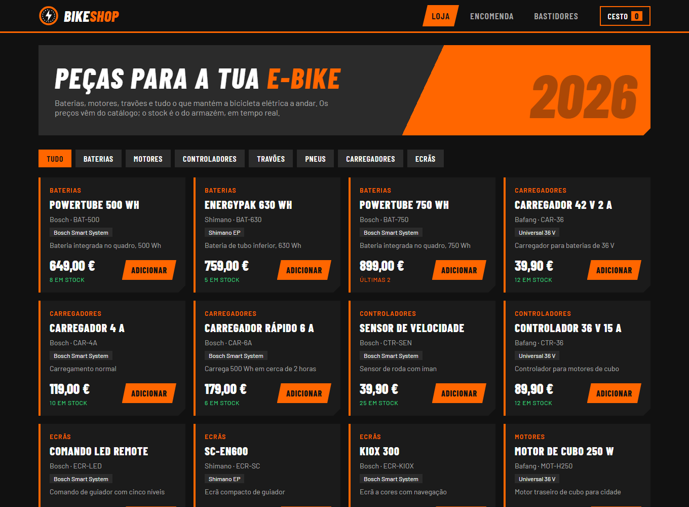
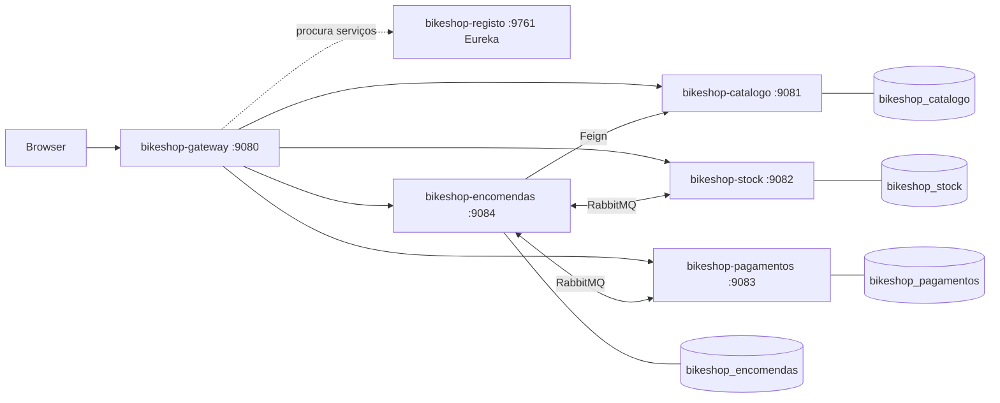
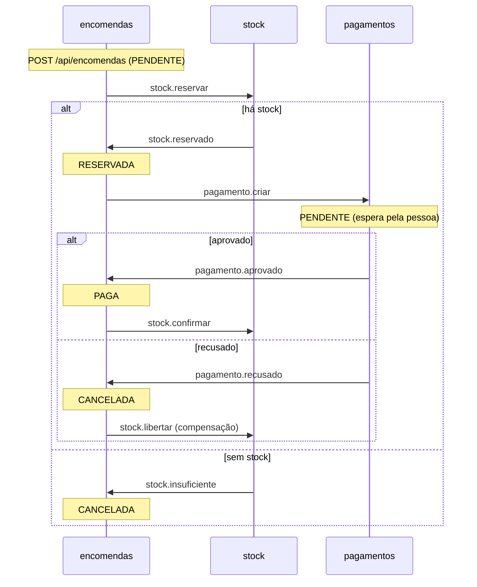
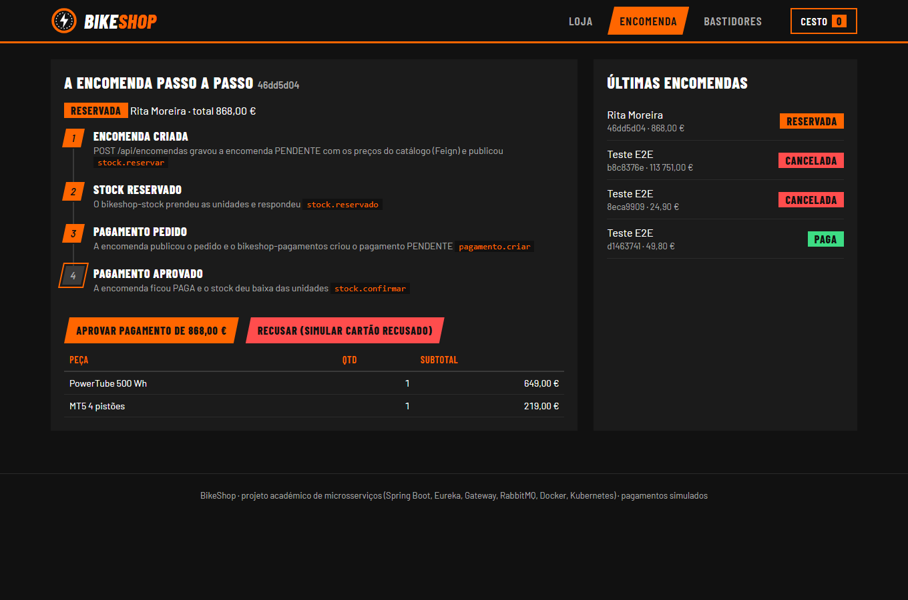
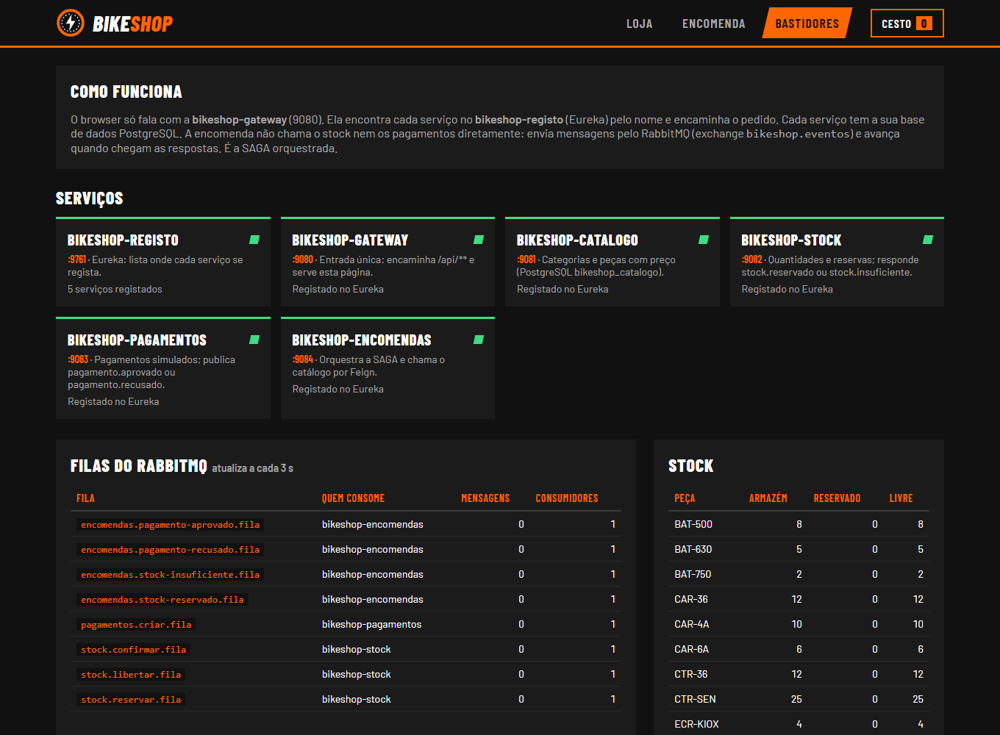

# BikeShop

Loja de peças para bicicletas elétricas (2026), feita em microsserviços com Spring Boot e Spring Cloud. É um projeto de estudo: pequeno de propósito, para se perceber como as peças encaixam. Usa as tecnologias dos slides da unidade curricular de Microsserviços (MTSDS, ESTG): Eureka, Gateway, OpenFeign, RabbitMQ, Docker e Kubernetes.

Os pagamentos são simulados: não há banco nem cartão.



## 1. Arquitetura

O browser só fala com a gateway. A gateway encontra cada serviço no registo (Eureka) pelo nome e encaminha o pedido. Cada serviço de negócio tem a sua base de dados. A encomenda chama o catálogo por HTTP (Feign) para saber nomes e preços. Com o stock e os pagamentos fala por mensagens (RabbitMQ).



| Módulo | Porta | O que faz | Base de dados |
|---|---|---|---|
| bikeshop-registo | 9761 | Eureka: onde os serviços se registam | nenhuma |
| bikeshop-gateway | 9080 | Entrada única (/api/**) e interface web | nenhuma |
| bikeshop-catalogo | 9081 | Categorias e peças, com preço | bikeshop_catalogo |
| bikeshop-stock | 9082 | Quantidades em armazém e reservas | bikeshop_stock |
| bikeshop-pagamentos | 9083 | Pagamento simulado (aprovar ou recusar) | bikeshop_pagamentos |
| bikeshop-encomendas | 9084 | Encomendas; orquestra a SAGA | bikeshop_encomendas |

Tabela 1: Módulos.

Cada serviço segue a mesma organização: controller, service, repository, entity, dto, configuration (com a MQConfig), messages, listeners, publishers e exception.

## 2. A SAGA da encomenda

Uma encomenda mexe em três serviços. Não há uma transação comum: cada passo é local e, se algo falhar depois, um passo de compensação desfaz o que já foi feito. Quem conduz é a encomenda (SAGA orquestrada).



Todas as mensagens passam pela exchange `bikeshop.eventos` (TopicExchange). Cada serviço declara as filas que consome.

| Routing key | Quem publica | Fila | Quem consome |
|---|---|---|---|
| stock.reservar | encomendas | stock.reservar.fila | stock |
| stock.reservado | stock | encomendas.stock-reservado.fila | encomendas |
| stock.insuficiente | stock | encomendas.stock-insuficiente.fila | encomendas |
| pagamento.criar | encomendas | pagamentos.criar.fila | pagamentos |
| pagamento.aprovado | pagamentos | encomendas.pagamento-aprovado.fila | encomendas |
| pagamento.recusado | pagamentos | encomendas.pagamento-recusado.fila | encomendas |
| stock.confirmar | encomendas | stock.confirmar.fila | stock |
| stock.libertar | encomendas | stock.libertar.fila | stock |

Tabela 2: Mensagens da SAGA.

Três regras tornam a SAGA segura:

- **Publicar só depois do commit.** O publisher regista o envio para depois do commit da transação, para nunca anunciar uma reserva ou uma encomenda que não ficou gravada.
- **Idempotência.** Uma mensagem repetida não reserva duas vezes nem cria dois pagamentos. Os estados da encomenda só avançam pela ordem certa (`marcarReservada`, `marcarPaga`, `cancelar`).
- **Tudo ou nada no stock.** Ou se reservam todas as linhas ou nenhuma.



## 3. Tecnologia

O ponto de partida são os slides da unidade curricular. O que não aparece neles ficou de fora para o projeto continuar pequeno.

| Tecnologia | Para quê | Onde nos slides |
|---|---|---|
| Spring Boot 3.5, Java 17, Lombok | Base de cada serviço | Slide 02 |
| Spring Data JPA, PostgreSQL (H2 nos testes) | Persistência, uma base por serviço | Slide 03 |
| Query JPQL própria (@Query) | Peças de uma categoria até um preço | Slide 03 |
| ModelMapper, auditoria JPA, /landing, erro com o nome do serviço | Boas práticas da API | Slide 04 |
| Eureka, Spring Cloud Gateway, OpenFeign e LoadBalancer | Registo, entrada única, chamadas entre serviços | Slide 04 |
| RabbitMQ (MQConfig, @RabbitListener, JSON) | Mensagens da SAGA | Slide 05 |
| Docker, Docker Compose, Kubernetes (Minikube) | Implementação | Slide 06 |

Tabela 3: Tecnologia e origem.

Fica de fora: Liquibase (as tabelas são criadas pelo Hibernate e os dados de exemplo vêm do `data.sql`), Redis, tracing, circuit breaker, MapStruct e Swagger.

## 4. Como correr

**Requisitos:** Docker Desktop. Para compilar, também o JDK 17 (o Maven vem no projeto, `mvnw`).

**Tudo em Docker (o mais simples):**

```powershell
.\scripts\arrancar.ps1        # infraestrutura, JAR, imagens e serviços; espera até responderem
.\scripts\e2e-test.ps1        # testa a SAGA ponta a ponta
.\scripts\parar.ps1           # para tudo e mantém os dados (-ApagarDados para começar do zero)
```

A interface fica em http://localhost:9080/ e a consola do RabbitMQ em http://localhost:15673 (bikeshop / bikeshop).

**Passo a passo, sem o script:**

```powershell
docker compose up -d --wait                                # PostgreSQL x4 e RabbitMQ (grupo bikeshop-infra)
.\mvnw.cmd package                                         # compila e corre os testes
docker compose -f docker-compose.apps.yml up -d --build    # os 6 serviços (grupo bikeshop-apps)
```

**Serviços no anfitrião (para programar):** com a infraestrutura a correr, arrancar cada módulo no IDE ou com `java -jar <módulo>\target\<módulo>.jar`, primeiro o `bikeshop-registo`. Os valores por omissão do `application.yml` apontam para `localhost` e para as portas da Tabela 5.

**Kubernetes (Minikube):**

```powershell
.\scripts\k8s-deploy.ps1                                        # perfil bikeshop-minikube, namespace bikeshop
kubectl port-forward -n bikeshop svc/bikeshop-gateway 19080:80  # interface em http://localhost:19080/
.\scripts\e2e-test.ps1 -Gateway http://localhost:19080
```

No cluster correm os 6 serviços. O PostgreSQL e o RabbitMQ ficam no Docker Compose e os pods chegam-lhes por `host.minikube.internal`, como o slide 06 sugere para a persistência.

## 5. Nomes

Os nomes dizem o que cada coisa é. O prefixo `bikeshop-` separa este projeto de outros no mesmo Docker.

| Objeto | Nome |
|---|---|
| Módulo Maven, JAR, imagem, container, Deployment e nome no Eureka | bikeshop-catalogo (e assim para os outros) |
| Grupos no Docker Desktop | bikeshop-infra (infraestrutura) e bikeshop-apps (serviços) |
| Bases de dados | bikeshop-postgres-catalogo, -stock, -pagamentos e -encomendas |
| Broker | bikeshop-rabbitmq |
| Imagens | bikeshop-<serviço>:1.0, com as etiquetas OCI de título e descrição |
| Volumes | bikeshop-postgres-<serviço>-dados e bikeshop-rabbitmq-dados |
| Rede | bikeshop-rede |
| Kubernetes | perfil bikeshop-minikube, namespace bikeshop |

Tabela 4: Nomes no Docker e no Kubernetes.

| Porta | O quê |
|---|---|
| 9080 a 9084, 9761 | Serviços |
| 55432 a 55435 | PostgreSQL (catálogo, stock, pagamentos, encomendas) |
| 5673, 15673 | RabbitMQ (AMQP e consola) |

Tabela 5: Portas no anfitrião. São diferentes das habituais para não colidirem com outros projetos.

## 6. API

Todos os caminhos passam pela gateway (http://localhost:9080).

| Método e caminho | Serviço | O que faz |
|---|---|---|
| GET /api/categorias | catálogo | Lista as categorias |
| GET /api/pecas?categoria=BAT&precoMax=700 | catálogo | Lista as peças (filtro opcional) |
| GET, PUT, DELETE /api/pecas/{referencia}; POST /api/pecas | catálogo | Consulta e gestão das peças |
| GET /api/stock, GET e PUT /api/stock/{referencia} | stock | Quantidades; o PUT repõe o armazém |
| GET /api/stock/reservas/{encomendaId} | stock | Reservas de uma encomenda |
| POST /api/encomendas, GET /api/encomendas/{id} | encomendas | Cria (202, PENDENTE) e consulta |
| GET /api/pagamentos/encomenda/{id} | pagamentos | Pagamento de uma encomenda |
| POST /api/pagamentos/encomenda/{id}/aprovar ou /recusar | pagamentos | Simula a resposta do banco |
| GET /api/<recurso>/landing | todos | Confirma que o serviço responde |

Tabela 6: API.

Exemplo de encomenda:

```json
POST /api/encomendas
{ "clienteNome": "Rita Moreira", "clienteEmail": "rita@bikeshop.pt",
  "linhas": [ { "referencia": "BAT-500", "quantidade": 1 } ] }
```

## 7. Testes

`.\mvnw.cmd verify` corre 31 testes, sem Docker (H2 em memória e RabbitMQ simulado):

- **unitários da SAGA:** a encomenda (agregado e estados), o serviço de encomendas, o stock (tudo ou nada, repetição, confirmar e libertar) e os pagamentos;
- **@DataJpaTest:** a query JPQL, a auditoria e a gravação da encomenda com as linhas;
- **@WebMvcTest:** o controller do catálogo, incluindo o erro 404 com o nome do serviço.

O `scripts\e2e-test.ps1` testa o sistema a correr, pela gateway: encomenda paga com o stock em baixo, pagamento recusado com o stock libertado (compensação) e encomenda sem stock.

## 8. Interface

A página é servida pela gateway e não usa bibliotecas:

- **Loja:** peças por categoria, stock em tempo real e cesto.
- **Encomenda:** a SAGA passo a passo e os botões para aprovar ou recusar o pagamento.
- **Bastidores:** estado dos serviços, registo no Eureka, filas do RabbitMQ e stock.



## 9. Pastas

```
pom.xml                    pai Maven (versões e plugins)
bikeshop-<serviço>/        um módulo por serviço, com o seu Dockerfile
docker-compose.yml         infraestrutura (grupo bikeshop-infra)
docker-compose.apps.yml    os 6 serviços (grupo bikeshop-apps)
k8s/                       namespace, ConfigMap, Secret e um manifesto por serviço
scripts/                   arrancar, parar, e2e-test e k8s-deploy
docs/capturas/             imagens deste README
```
