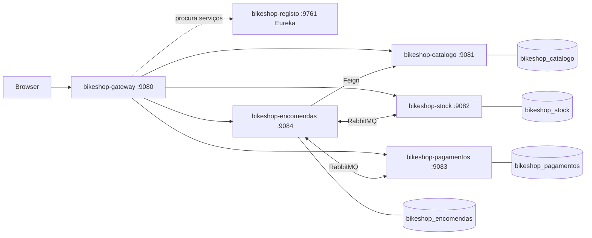
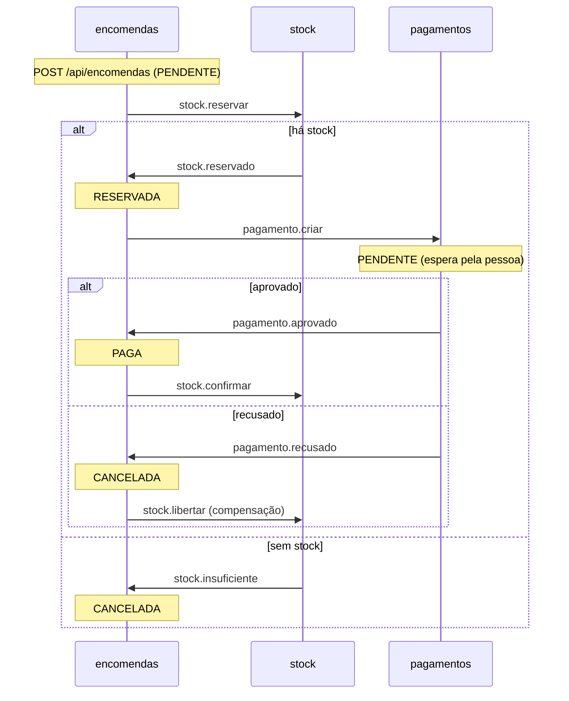

# BikeShop

Loja de peças para bicicletas elétricas (2026), feita em microsserviços com Spring Boot e Spring Cloud. É um projeto de estudo: pequeno de propósito, para se perceber como as peças encaixam. Usa as tecnologias dos slides da unidade curricular de Microsserviços (MTSDS, ESTG): Eureka, Gateway, OpenFeign, RabbitMQ, Docker e Kubernetes.

Os pagamentos são simulados: não há banco nem cartão.

## 1. Arquitetura

O browser só fala com a gateway. A gateway encontra cada serviço no registo (Eureka) pelo nome e encaminha o pedido. Cada serviço de negócio tem a sua base de dados. A encomenda chama o catálogo por HTTP (Feign) para saber nomes e preços. Com o stock e os pagamentos fala por mensagens (RabbitMQ).



| Módulo | Porta | O que faz | Base de dados |
|---|---|---|---|
| bikeshop-registo | 9761 | Eureka: onde os serviços se registam | nenhuma |
| bikeshop-gateway | 9080 | Entrada única (/api/**) e interface web | nenhuma |
| bikeshop-catalogo | 9081 | Categorias e peças, com preço | bikeshop_catalogo |
| bikeshop-stock | 9082 | Quantidades em armazém e reservas | bikeshop_stock |
| bikeshop-pagamentos | 9083 | Pagamento simulado (aprovar ou recusar) | bikeshop_pagamentos |
| bikeshop-encomendas | 9084 | Encomendas; orquestra a SAGA | bikeshop_encomendas |

Tabela 1: Módulos.

Cada serviço segue a mesma organização: controller, service, repository, entity, dto, configuration (com a MQConfig), messages, listeners, publishers e exception.

## 2. A SAGA da encomenda

Uma encomenda mexe em três serviços. Não há uma transação comum: cada passo é local e, se algo falhar depois, um passo de compensação desfaz o que já foi feito. Quem conduz é a encomenda (SAGA orquestrada).



Todas as mensagens passam pela exchange `bikeshop.eventos` (TopicExchange). Cada serviço declara as filas que consome.

| Routing key | Quem publica | Fila | Quem consome |
|---|---|---|---|
| stock.reservar | encomendas | stock.reservar.fila | stock |
| stock.reservado | stock | encomendas.stock-reservado.fila | encomendas |
| stock.insuficiente | stock | encomendas.stock-insuficiente.fila | encomendas |
| pagamento.criar | encomendas | pagamentos.criar.fila | pagamentos |
| pagamento.aprovado | pagamentos | encomendas.pagamento-aprovado.fila | encomendas |
| pagamento.recusado | pagamentos | encomendas.pagamento-recusado.fila | encomendas |
| stock.confirmar | encomendas | stock.confirmar.fila | stock |
| stock.libertar | encomendas | stock.libertar.fila | stock |

Tabela 2: Mensagens da SAGA.

Três regras tornam a SAGA segura:

- **Publicar só depois do commit.** O publisher regista o envio para depois do commit da transação, para nunca anunciar uma reserva ou uma encomenda que não ficou gravada.
- **Idempotência.** Uma mensagem repetida não reserva duas vezes nem cria dois pagamentos. Os estados da encomenda só avançam pela ordem certa (`marcarReservada`, `marcarPaga`, `cancelar`).
- **Tudo ou nada no stock.** Ou se reservam todas as linhas ou nenhuma.

## 3. Tecnologia

O ponto de partida são os slides da unidade curricular. O que não aparece neles ficou de fora para o projeto continuar pequeno.

| Tecnologia | Para quê | Onde nos slides |
|---|---|---|
| Spring Boot 3.5, Java 17, Lombok | Base de cada serviço | Slide 02 |
| Spring Data JPA, PostgreSQL (H2 nos testes) | Persistência, uma base por serviço | Slide 03 |
| Query JPQL própria (@Query) | Peças de uma categoria até um preço | Slide 03 |
| ModelMapper, auditoria JPA, /landing, erro com o nome do serviço | Boas práticas da API | Slide 04 |
| Eureka, Spring Cloud Gateway, OpenFeign e LoadBalancer | Registo, entrada única, chamadas entre serviços | Slide 04 |
| RabbitMQ (MQConfig, @RabbitListener, JSON) | Mensagens da SAGA | Slide 05 |
| Docker, Docker Compose, Kubernetes (Minikube) | Implementação | Slide 06 |

Tabela 3: Tecnologia e origem.

O que os slides pedem, o que está feito e o que fica de fora (e porquê) está na secção 11.

## 4. Como correr

O passo a passo, com os resultados esperados e o que fazer se correr mal, está no `RUNBOOK.html` (abrir no browser).

**Requisitos:** Docker Desktop. Para compilar, também o JDK 17 (o Maven vem no projeto, `mvnw`).

**Tudo em Docker (o mais simples):**

```powershell
.\scripts\arrancar.ps1        # infraestrutura, JAR, imagens e serviços; espera até responderem
.\scripts\e2e-test.ps1        # testa a SAGA ponta a ponta
.\scripts\parar.ps1           # para tudo e mantém os dados (-ApagarDados para começar do zero)
```

A interface fica em http://localhost:9080/, a consola do RabbitMQ em http://localhost:15673 (bikeshop / bikeshop) e o Adminer, para ver as bases de dados, em http://localhost:18081 (sistema PostgreSQL, servidor `bikeshop-postgres-<serviço>`, bikeshop / bikeshop, base de dados `bikeshop_<serviço>`).

**Passo a passo, sem o script:**

```powershell
docker compose up -d --wait                                # PostgreSQL x4, RabbitMQ e Adminer (grupo bikeshop-infra)
.\mvnw.cmd package                                         # compila e corre os testes
docker compose -f docker-compose.apps.yml up -d --build    # os 6 serviços (grupo bikeshop-apps)
```

**Serviços no anfitrião (para programar):** com a infraestrutura a correr, arrancar cada módulo no IDE ou com `java -jar <módulo>\target\<módulo>.jar`, primeiro o `bikeshop-registo`. No IntelliJ e no VS Code há a configuração **BikeShop (todos)**, que arranca os 6 (`.run/` e `.vscode/launch.json`). Os valores por omissão do `application.yml` apontam para `localhost` e para as portas da Tabela 5.

**Kubernetes (Minikube):**

```powershell
.\scripts\k8s-deploy.ps1                                        # perfil bikeshop-minikube, namespace bikeshop
kubectl port-forward -n bikeshop svc/bikeshop-gateway 19080:80  # interface em http://localhost:19080/
.\scripts\e2e-test.ps1 -Gateway http://localhost:19080
```

No cluster correm os 6 serviços, o catálogo com 2 réplicas. O PostgreSQL e o RabbitMQ ficam no Docker Compose e os pods chegam-lhes por `host.minikube.internal`, como o slide 06 sugere para a persistência.

**Ver o balanceamento (slides 04 e 06):** cada pedido a `GET /api/pecas/{referencia}` escreve no log a instância que respondeu. Depois de alguns pedidos (por exemplo, o `e2e-test.ps1`), os dois pods aparecem:

```powershell
kubectl logs -n bikeshop -l app=bikeshop-catalogo --prefix | Select-String "respondeu a instância"
kubectl scale deployment bikeshop-catalogo -n bikeshop --replicas=3   # mais uma instância
```

**Docker Hub (slide 06):** depois de `docker login`, `.\scripts\publicar-dockerhub.ps1 -Utilizador <conta>` faz `docker tag` e `docker push` das 6 imagens como `<conta>/bikeshop-<serviço>:1.0` (`-Versao` para outra versão). Estão publicadas a 1.0 e a 2.0 em https://hub.docker.com/u/8220800.

**Nova versão em produção no Minikube (exercício do slide 06):** a 2.0 acrescenta `GET /api/pecas/marca/{marca}` ao catálogo. Depois de a publicar, o `k8s-atualizar.ps1` muda o Deployment para a imagem do Docker Hub e acompanha a substituição dos pods, um de cada vez:

```powershell
.\scripts\arrancar.ps1 -Compilar                                       # imagens locais com o código novo
.\scripts\publicar-dockerhub.ps1 -Utilizador 8220800 -Versao 2.0
.\scripts\k8s-atualizar.ps1 -Utilizador 8220800 -Servico catalogo -Versao 2.0
kubectl get pods -n bikeshop -l app=bikeshop-catalogo -w                # noutro terminal: os pods a serem recriados
kubectl rollout undo deployment/bikeshop-catalogo -n bikeshop           # voltar à versão anterior
```

O `k8s-deploy.ps1` volta a aplicar os manifestos de `k8s/`, com as imagens locais 1.0.

**Postman (slides 03 e 04):** importar `postman/bikeshop.postman_collection.json` e correr a coleção por ordem (Runner). São 37 pedidos pela gateway, com todos os endpoints e os casos de erro (404, 400 de validação, JSON mal formado, UUID inválido, aprovar duas vezes). Cada pedido tem testes do código HTTP; a encomenda criada fica na variável `encomendaId` para os pedidos seguintes.

## 5. Nomes

Os nomes dizem o que cada coisa é. O prefixo `bikeshop-` separa este projeto de outros no mesmo Docker.

| Objeto | Nome |
|---|---|
| Módulo Maven, JAR, imagem, container, Deployment e nome no Eureka | bikeshop-catalogo (e assim para os outros) |
| Grupos no Docker Desktop | bikeshop-infra (infraestrutura) e bikeshop-apps (serviços) |
| Bases de dados | bikeshop-postgres-catalogo, -stock, -pagamentos e -encomendas |
| Broker | bikeshop-rabbitmq |
| Gestão das BD | bikeshop-adminer |
| Imagens | bikeshop-<serviço>:1.0, com as etiquetas OCI de título e descrição |
| Volumes | bikeshop-postgres-<serviço>-dados e bikeshop-rabbitmq-dados |
| Rede | bikeshop-rede |
| Kubernetes | perfil bikeshop-minikube, namespace bikeshop |

Tabela 4: Nomes no Docker e no Kubernetes.

| Porta | O quê |
|---|---|
| 9080 a 9084, 9761 | Serviços |
| 55432 a 55435 | PostgreSQL (catálogo, stock, pagamentos, encomendas) |
| 5673, 15673 | RabbitMQ (AMQP e consola) |
| 18081 | Adminer (gestão das bases de dados) |

Tabela 5: Portas no anfitrião. São diferentes das habituais para não colidirem com outros projetos.

## 6. API

Todos os caminhos passam pela gateway (http://localhost:9080).

| Método e caminho | Serviço | O que faz |
|---|---|---|
| GET /api/categorias | catálogo | Lista as categorias |
| GET /api/pecas?categoria=BAT&precoMax=700 | catálogo | Lista as peças (filtro opcional) |
| GET /api/pecas/marca/Bosch | catálogo | Peças de uma marca, por preço (versão 2.0) |
| GET, PUT, DELETE /api/pecas/{referencia}; POST /api/pecas | catálogo | Consulta e gestão das peças |
| GET /api/stock, GET e PUT /api/stock/{referencia} | stock | Quantidades; o PUT repõe o armazém |
| GET /api/stock/reservas/{encomendaId} | stock | Reservas de uma encomenda |
| POST /api/encomendas, GET /api/encomendas/{id} | encomendas | Cria (202, PENDENTE) e consulta |
| GET /api/pagamentos/encomenda/{id} | pagamentos | Pagamento de uma encomenda |
| POST /api/pagamentos/encomenda/{id}/aprovar ou /recusar | pagamentos | Simula a resposta do banco |
| GET /api/<recurso>/landing | todos | Confirma que o serviço responde |

Tabela 6: API.

Exemplo de encomenda:

```json
POST /api/encomendas
{ "clienteNome": "Rita Moreira", "clienteEmail": "rita@bikeshop.pt",
  "linhas": [ { "referencia": "BAT-500", "quantidade": 1 } ] }
```

## 7. Testes

`.\mvnw.cmd verify` corre 54 testes, sem Docker (H2 em memória e RabbitMQ simulado):

- **unitários da SAGA:** a encomenda (agregado e estados), o serviço de encomendas, o stock (tudo ou nada, repetição, confirmar e libertar) e os pagamentos;
- **@DataJpaTest:** a query JPQL, a procura por marca, a auditoria e a gravação da encomenda com as linhas;
- **OpenFeign (`CatalogoClientTest`):** o `CatalogoClient` a sério, contra duas instâncias falsas do catálogo declaradas no discovery simples. Confirma o JSON, que o LoadBalancer reparte os pedidos pelas duas e que o 404 do catálogo chega à encomenda como 400;
- **@WebMvcTest:** os controllers dos quatro serviços de negócio, incluindo o `/landing`, o erro 404 com o nome do serviço e os 400 de validação, de JSON mal formado e de identificador inválido.

Nos testes o log fica só na consola (`src/test/resources/logback-test.xml`).

O `scripts\e2e-test.ps1` testa o sistema a correr, pela gateway: encomenda paga com o stock em baixo, pagamento recusado com o stock libertado (compensação) e encomenda sem stock.

## 8. Interface

A interface é servida pela gateway, a partir de `bikeshop-gateway/src/main/resources/static` (a pasta que o Spring Boot serve sozinho): só HTML, CSS e JS, sem bibliotecas. Assim a gateway continua a ser o único ponto de entrada de todos os pedidos HTTP (slide 04), e as páginas e a API ficam na mesma origem, sem CORS. O aspeto é uma réplica da interface do projeto GameShop (cores, cartões, cantos, sombras, tipografia e tema claro/escuro), com o laranja do BikeShop no lugar do índigo e o logótipo do BikeShop.

- **Cabeçalho**, igual em todas as páginas: o logótipo leva à visão geral, o botão **Loja** e, logo a seguir, o menu **Ferramentas** (Eureka, consola do RabbitMQ, Adminer e o `/landing` de cada serviço, com indicação de se estão a responder). À direita há um botão por equipa (Catálogo, Encomenda, Armazém, Pagamento), com o estado dos seus serviços e a ligação à ficha de cada um.
- **index.html (visão geral):** arquitetura com o estado de cada serviço, o grupo, os passos da SAGA, a tabela das mensagens e, "ao vivo", as filas do RabbitMQ e o stock.
- **loja.html:** catálogo por categoria com o stock em tempo real, cesto, a encomenda com a SAGA passo a passo (botões para aprovar ou recusar o pagamento) e as últimas encomendas. A encomenda aberta fica no endereço (`loja.html#<id>`).
- **servico.html?id=<serviço>:** ficha de cada microsserviço (o que faz, como encaixa, dados, API, decisões, testes, como correr), com um painel **Experimentar** que faz pedidos reais pela gateway e mostra a resposta completa.

Os textos das fichas, as equipas e as ferramentas estão em `js/servicos.js`. Para pôr os nomes dos elementos do grupo, basta alterar o campo `nome` em `GRUPO`. O `js/app.js` desenha o cabeçalho e o rodapé e verifica o estado dos serviços.

## 9. Pastas

```
pom.xml                    pai Maven (versões e plugins)
bikeshop-<serviço>/        um módulo por serviço, com o seu Dockerfile
docker-compose.yml         infraestrutura (grupo bikeshop-infra)
docker-compose.apps.yml    os 6 serviços (grupo bikeshop-apps)
k8s/                       namespace, ConfigMap, Secret e um manifesto por serviço
scripts/                   arrancar, parar, e2e-test, k8s-deploy, k8s-atualizar e publicar-dockerhub
postman/                   coleção Postman (a pasta docs/, com os slides, fica fora do Git)
RUNBOOK.html               como arrancar: Docker, IDE e Kubernetes
.run/, .vscode/            arranque pelo IntelliJ e pelo VS Code (BikeShop (todos))
```

## 10. Desenvolvimento

Comandos úteis além dos da secção 4 (a partir da raiz; em Git Bash usar `./mvnw`):

```powershell
.\mvnw.cmd verify                                              # todos os módulos e testes
.\mvnw.cmd -pl bikeshop-stock -am verify                       # só um módulo
.\mvnw.cmd -pl bikeshop-stock test -Dtest=StockServiceTest     # só uma classe de teste
.\mvnw.cmd -pl bikeshop-stock test "-Dtest=StockServiceTest#semStockNaoReservaNada"   # só um método
.\mvnw.cmd package -DskipTests                                 # JARs sem testes
```

O JAR de cada módulo chama-se como o módulo (`<finalName>` no pom pai), porque os Dockerfiles copiam `target/<módulo>.jar`. As versões (Spring Boot 3.5.6, Spring Cloud 2025.0.0, Lombok, ModelMapper) estão só no `pom.xml` pai.

O que é preciso saber antes de mexer:

- **Não há módulo partilhado.** Cada serviço tem as suas classes de mensagens (`messages/`) com os mesmos campos: o contrato é o JSON. O `MessageConverter` de cada `MQConfig` usa `TypePrecedence.INFERRED`, por isso o nome da classe Java não tem de coincidir entre serviços, mas os nomes dos campos sim. Ao mudar uma mensagem, mudar o publicador e o consumidor.
- **Cada `MQConfig` declara a exchange `bikeshop.eventos` e só as filas que esse serviço consome**, com as routing keys como constantes. Uma nova mensagem na SAGA: constante e fila/binding no `MQConfig` de quem consome, `@RabbitListener` em `listeners/`, e envio pelo publisher de quem publica (Tabela 2).
- **Publicar sempre pelo publisher do serviço** (`publishers/`), nunca com o `RabbitTemplate` direto: é ele que adia o envio para depois do commit (`TransactionSynchronization.afterCommit`).
- **Os listeners só delegam no service**; a idempotência e as transições de estado ficam no service e na entidade (`Encomenda.marcarReservada`, `marcarPaga`, `cancelar`). Com `default-requeue-rejected: false`, uma mensagem que lança exceção é descartada, não repetida.
- **Interface:** os ficheiros estão em `bikeshop-gateway/src/main/resources/static` e vão dentro do JAR da gateway. Depois de os alterar: `.\mvnw.cmd -pl bikeshop-gateway package -DskipTests` e `docker compose -f docker-compose.apps.yml up -d --build bikeshop-gateway`.
- **Uma rota nova na API** tem de ser acrescentada às rotas do `bikeshop-gateway/src/main/resources/application.yml` (`lb://<nome no Eureka>`), senão o browser não lhe chega.
- **Chamadas síncronas entre serviços** só por Feign com o nome no Eureka (ex.: `@FeignClient(name = "bikeshop-catalogo")` em `bikeshop-encomendas/clients`).
- **Erros** saem do `ErroHandler` de cada serviço como JSON `{servico, estado, mensagem}`; lançar `NaoEncontradoException` para 404 e `IllegalArgumentException` para 400. JSON mal formado e identificadores inválidos dão 400. Um erro inesperado fica registado no log com o detalhe e o cliente recebe só uma mensagem genérica (500).
- **Logging** (SLF4J com Logback): `logback-spring.xml` em cada serviço escreve na consola e em `logs/<serviço>.log`, com rotação diária e por tamanho. Nos containers a pasta é `/app/logs` (`docker exec bikeshop-stock ls logs`). Usar `@Slf4j` e mensagens parametrizadas (`log.info("... {}", valor)`).
- **Banner:** cada serviço mostra no arranque o `banner.txt` com o seu nome e a porta.
- **Configuração:** o `application.yml` de cada serviço tem valores por omissão para o anfitrião e lê `DB_HOST`, `DB_PORT`, `RABBITMQ_HOST`, `EUREKA_HOST`, etc. das variáveis de ambiente, que vêm do `docker-compose.apps.yml` ou do `k8s/01-configmap.yaml` e `02-secret.yaml`. Uma variável nova tem de ir para os dois sítios.
- **Testes** usam `src/test/resources/application.yml`: H2 com `create-drop`, Eureka desligado e listeners do RabbitMQ com `auto-startup: false`. Não precisam de Docker.
- **Dados de exemplo** vêm do `data.sql` (catálogo e stock); as referências das peças (ex.: `BAT-500`) têm de existir nos dois.

## 11. Conformidade com os slides MTSDS

Revisão do projeto contra os slides oficiais da UC (01 a 06, em `docs/`, fora do Git). "Feito" quer dizer que já estava aplicado; "Acrescentado" foi aplicado nesta revisão.

| Slide | O que pede | Estado | Onde |
|---|---|---|---|
| 01 | Microsserviços autónomos, cada um uma aplicação Spring Boot | Feito | 6 módulos, cada um com o seu JAR e imagem |
| 01 | Spring Cloud: service discovery, load balancer, API gateway | Feito | registo (Eureka), gateway, `lb://` e Feign |
| 02 | Projeto Maven multi-módulo, versões no `dependencyManagement` do pai | Feito | `pom.xml` |
| 02 | `application.yml` por módulo, com porta própria | Feito | `src/main/resources/application.yml` |
| 02 | `banner.txt` por serviço ("boa prática") | Acrescentado | `src/main/resources/banner.txt` |
| 02 | Lombok | Feito | entidades, DTO, services |
| 02 | Logging com SLF4J (Logback) e mensagens parametrizadas | Feito; ficheiro acrescentado | `@Slf4j`, `logback-spring.xml` |
| 02 | Packages por camada (controllers, models, exceptions, data…) | Feito | Tabela 1 |
| 02 | `@RestController`, `ResponseEntity`, códigos HTTP certos (200, 201, 202, 204, 400, 404) | Feito | controllers e `ErroHandler` |
| 02 | Testes com MockMvc ("boa prática") | Acrescentado (todos os controllers) | `*ControllerTest` |
| 02 | Actuator, sem expor tudo em produção | Feito | só `health` e `info`, com probes |
| 03 | Spring Data JPA, `JpaRepository`, queries pelo nome do método | Feito | `repository/` |
| 03 | `@Query` em JPQL | Feito | `PecaRepository` |
| 03 | `@OneToMany`/`@ManyToOne`, `mappedBy`, `cascade` | Feito | `Encomenda`/`LinhaEncomenda`, `Peca`/`Categoria` |
| 03 | Auditoria `@CreatedDate`/`@LastModifiedDate` com `@EntityListeners` | Feito | entidades e `@EnableJpaAuditing` |
| 03 | Camada de serviço com `@Service` e `@Transactional` | Feito | `service/` |
| 03 | PostgreSQL em Docker Compose, com volume; H2 nos testes | Feito | `docker-compose.yml`, `src/test/resources` |
| 03 | Não mandar o detalhe técnico do erro ao cliente; registar no log | Acrescentado | `ErroHandler` (500 genérico com `log.error`) |
| 03 | Testes unitários para os vários endpoints | Acrescentado | 54 testes (secção 7) |
| 03/04 | Testar com o Postman, incluindo as exceções | Acrescentado | `postman/bikeshop.postman_collection.json` |
| 04 | DTO em vez de entidades na API ("boa prática") | Feito; corrigido nas reservas | `dto/`, `ReservaDto` |
| 04 | ModelMapper | Feito | `@Bean` em cada `configuration/` |
| 04 | `spring.application.name` único | Feito | Tabela 4 |
| 04 | `/landing` em cada serviço | Feito | Tabela 6 |
| 04 | Exceções próprias e `@ControllerAdvice`, erro com o nome do serviço | Feito | `exception/` |
| 04 | Spring Cloud Gateway com rotas e integração com o Eureka | Feito | `bikeshop-gateway/src/main/resources/application.yml` |
| 04 | Eureka server que não se regista a si próprio; clientes em todos os serviços | Feito | `bikeshop-registo` |
| 04 | OpenFeign com o nome do serviço (usa o load balancer) | Feito | `CatalogoClient` |
| 04 | Testes que usam o OpenFeign (exercício) | Acrescentado | `CatalogoClientTest` |
| 04 | Ferramenta de gestão da BD ao lado do PostgreSQL (Adminer/pgAdmin) | Acrescentado | `bikeshop-adminer` no `docker-compose.yml` |
| 04 | Várias instâncias e ver o balanceamento no log | Acrescentado | catálogo com 2 réplicas em `k8s/`, log da instância |
| 04 | Logback com ficheiro local (exercício) | Acrescentado | `logs/<serviço>.log` |
| 05 | `spring-boot-starter-amqp`, `MQConfig` com exchange, filas e bindings | Feito | `configuration/MQConfig` |
| 05 | TopicExchange e routing keys | Feito | Tabela 2 |
| 05 | `Jackson2JsonMessageConverter` no produtor e no consumidor | Feito | `MQConfig` |
| 05 | `@RabbitListener` e package `messages` | Feito | `listeners/`, `messages/` |
| 05 | RabbitMQ com consola de gestão em Docker | Feito | `docker-compose.yml` (porta 15673) |
| 05 | Resiliência: parar o consumidor e ver as mensagens esperarem na fila | Feito | filas duráveis; ver na interface (Ao vivo) ou na consola |
| 06 | Dockerfile por serviço, `spring-boot-maven-plugin`, JAR com nome fixo | Feito | `bikeshop-*/Dockerfile`, `<finalName>` |
| 06 | `docker tag` e `docker push` para o Docker Hub, com versão | Acrescentado | `scripts/publicar-dockerhub.ps1` (1.0 e 2.0) |
| 06 | Nova versão em produção e acompanhar a recriação dos pods (exercício) | Acrescentado | `scripts/k8s-atualizar.ps1` (catálogo 2.0) |
| 06 | Minikube e kubectl; pasta com os YAML | Feito | `k8s/`, `scripts/k8s-deploy.ps1` |
| 06 | Deployment com réplicas e Service (LoadBalancer na entrada) | Feito; réplicas acrescentadas | `k8s/bikeshop-*.yaml` |
| 06 | ConfigMap e Secret para separar a configuração do código | Feito | `k8s/01-configmap.yaml`, `02-secret.yaml` |
| 06 | `kubectl scale`, `logs`, `describe` | Feito | secção 4 |

Tabela 7: Conformidade com os slides.

Os exercícios do fim de cada slide são feitos sobre aplicações de demonstração (MedicalControl, carShop, MyBank, inventory). A tabela seguinte mostra a que corresponde cada um no BikeShop.

| Slide | Exercício | No BikeShop |
|---|---|---|
| 02 | Repositório simulado e, depois, uma base de dados real | PostgreSQL; H2 nos testes |
| 02 | Registar quem acedeu aos dados e quando | Só o quando (`@CreatedDate`/`@LastModifiedDate`); não há utilizadores com sessão |
| 03 | PUT e DELETE | `PUT/DELETE /api/pecas/{referencia}`, `PUT /api/stock/{referencia}` |
| 03 | Endpoint com query própria (JPQL ou nativa) | `GET /api/pecas?categoria=&precoMax=` |
| 03 | Testes unitários para os vários endpoints | `@WebMvcTest` nos 4 controllers |
| 04 | Uma BD por serviço em Docker, com ferramenta de gestão | 4 PostgreSQL e o Adminer |
| 04 | Validar condições antes de mudar o estado | SAGA: reserva de stock, pagamento e compensação |
| 04 | OpenFeign entre serviços, com testes | `CatalogoClient` e `CatalogoClientTest` |
| 04 | Logging em ficheiro, sem detalhe técnico para o cliente; erros por email | Ficheiro e `ErroHandler`; o email fica de fora |
| 04 | Segunda instância e balanceamento pelo Postman | Catálogo com 2 réplicas; o log diz a instância |
| 04 | Imagem Docker de cada serviço e o projeto todo no Minikube | Dockerfiles e `k8s/` |
| 05 | Persistência nos serviços e rastreabilidade entre eles | Reservas e pagamentos guardam o `encomendaId` |
| 05 | Producer e consumer nos dois sentidos | Mensagens de ida e volta da SAGA (Tabela 2) |
| 05 | Decisão automática e assíncrona | Stock e pagamentos reagem às mensagens |
| 06 | Novo endpoint, versão 2.0 no Docker Hub e no Minikube | `GET /api/pecas/marca/{marca}`, `k8s-atualizar.ps1` |
| 06 | Serviço com duas réplicas; aumentar e acompanhar com kubectl | Catálogo com 2 réplicas, `kubectl scale` (secção 4) |

Tabela 8: Exercícios dos slides.

**Fora de âmbito, de propósito.** Os slides só os mencionam, sem pedir que se apliquem; ficam de fora para o projeto continuar pequeno:

- **Swagger/OpenAPI, Liquibase/Flyway, MapStruct:** não aparecem nos slides. As tabelas são criadas pelo Hibernate (`ddl-auto`, slide 03) e os dados vêm do `data.sql`.
- **Circuit breaker (Resilience4j), tracing (Zipkin), Spring Cloud Config:** só listados no slide 01 como serviços do Spring Cloud.
- **Spring Security:** só listado como módulo (slides 01 e 02); o slide 04 diz que a autenticação "pode ser feita" na gateway.
- **Dead-letter exchange, retries e ack manual no RabbitMQ:** só no glossário do slide 05.
- **Ingress, PersistentVolume e StatefulSet:** só como conceitos no slide 06, que sugere manter a persistência fora do cluster.
- **Eureka em vários nós e erros enviados por email:** recomendação e exercício do slide 04 que pedem infraestrutura extra (mais nós, servidor de email).
